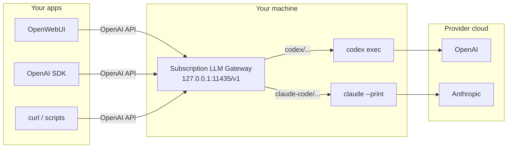
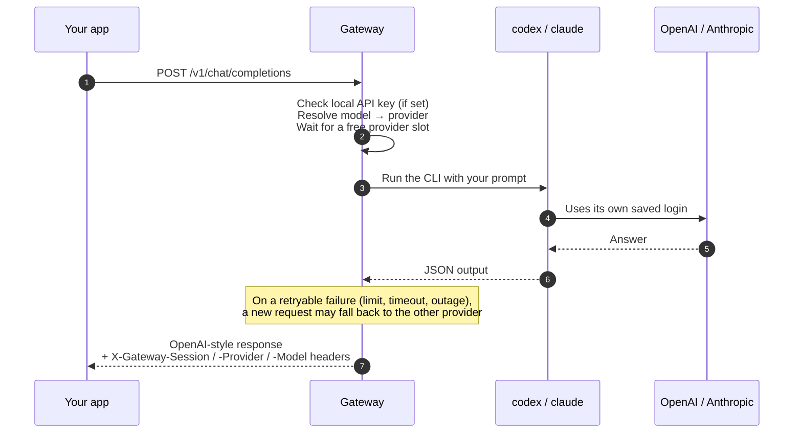

# Subscription LLM Gateway

[](https://github.com/chrysogonus/subscription-gateway/actions/workflows/ci.yml)
[](LICENSE)
[](https://www.python.org/downloads/)
[](https://github.com/astral-sh/ruff)
[](https://mypy-lang.org/)

**Use the Codex and Claude Code logins you already have from any app that speaks the OpenAI
API.**

Point OpenWebUI, the OpenAI Python SDK, or `curl` at `http://127.0.0.1:11435/v1`. The gateway
runs your request through the official `codex` or `claude` command-line client on your machine
and hands back an ordinary OpenAI-style response.



> [!NOTE]
> Inference is **not** local. Codex and Claude Code still run on OpenAI and Anthropic
> infrastructure, under your plan's terms and usage limits.

## What it is — and what it is not

| ✅ It is | ❌ It is not |
| --- | --- |
| A personal, localhost-first adapter for apps that accept a custom OpenAI base URL | A local model |
| A thin wrapper that runs the official, already signed-in CLIs | A replacement for the OpenAI or Anthropic developer APIs |
| Honest about what it runs: models are named `codex/...` and `claude-code/...` | A way to share, resell, or stretch a subscription past its rate limits |
| Credential-free: login stays with the CLIs; only session metadata is stored | A credential extraction tool, or a raw model API with identical behavior |

The gateway never reads browser cookies, extracts bearer tokens, intercepts provider traffic, or
calls undocumented endpoints. The only thing it stores is gateway-to-provider session metadata
in SQLite.

## Choose your setup

| Setup | Best for | Start with | Then open |
| --- | --- | --- | --- |
| **Native** | Scripts and SDKs on this machine | `make install && make serve` | `http://127.0.0.1:11435/v1` |
| **Docker** | Isolation, pinned CLI versions | `make up` | `http://127.0.0.1:11435/v1` |
| **Docker + OpenWebUI** | A ready-made chat UI | `make up-webui` | `http://127.0.0.1:3001` |

## Quickstart (native)

**You need:** Python 3.12+, `make`, and at least one of the two CLIs.
[uv](https://docs.astral.sh/uv/) is used when present; otherwise a `.venv` is created with pip.

**1. Sign in to the CLIs you want to use** (either one is enough):

```bash
codex login            # ChatGPT login  → enables codex/* models
claude auth login      # Claude login   → enables claude-code/* models
```

**2. Install the gateway:**

```bash
git clone https://github.com/chrysogonus/subscription-gateway.git
cd subscription-gateway
make install
```

**3. Check the setup, then start it:**

```bash
make doctor            # [PASS]/[WARN] for Python, each CLI, storage, and the port
make serve             # listens on http://127.0.0.1:11435/v1
```

The `make` targets run the CLI inside the project environment. To call it directly, use
`uv run subscription-gateway ...` or activate `.venv` first.

**4. Send a request** from another terminal:

```bash
curl http://127.0.0.1:11435/v1/chat/completions \
  -H 'Content-Type: application/json' \
  -d '{
    "model": "subscription/auto",
    "messages": [{"role": "user", "content": "Explain Linux namespaces."}]
  }'
```

Native mode needs no API key on loopback. Docker always does: send
`-H 'Authorization: Bearer local'` (the Compose default). See the [Docker guide](docs/docker.md).

## How a request flows



Send the `X-Gateway-Session` value back to continue the same conversation. See
[Sessions](docs/api.md#sessions).

## Models

These appear in `/v1/models` and in a client's model picker:

| Model | Runs as |
| --- | --- |
| `codex/gpt-5.6-sol` | `codex --model gpt-5.6-sol` |
| `claude-code/opus` | `claude --model opus` |
| `claude-code/sonnet` | `claude --model sonnet` |
| `claude-code/haiku` | `claude --model haiku` |
| `claude-code/fable` | `claude --model fable` |
| `subscription/auto` | the default model of the first provider in `routing.order` (Codex, then Claude), moving to the next one if it is not ready |

Any other model the CLI accepts also works without configuration, for example
`claude-code/claude-fable-5` or `codex/gpt-6-luna`. To show one in a model picker, add it to
`config.yaml`. See [Models and routing](docs/models-and-routing.md).

## Endpoints at a glance

| Endpoint | What it does |
| --- | --- |
| `GET /health`, `GET /ready` | Liveness, and whether any provider is ready |
| `GET /v1/models` | Models from the ready providers |
| `POST /v1/chat/completions` | OpenAI Chat Completions (text only), with streaming |
| `POST /v1/responses` | A text subset of the OpenAI Responses API |
| `POST /v1/agents/run` | A Claude Code agent run inside an allowed directory, read-only or with edits |

Full request and response details, error codes, and examples are in the [API guide](docs/api.md).

## Subscription logins are for your own use

Both CLIs can sign in with a subscription (ChatGPT or Claude) or with an API key. The gateway
works with either, but the terms differ:

| Login | Allowed use |
| --- | --- |
| **Subscription** (`codex login`, `claude auth login`) | One person, on their own machine, with their own account |
| **API key** (`codex login --with-api-key`, `ANTHROPIC_API_KEY`) | Anything shared, remote, multi-user, or automated beyond your own use; billed at API rates |

> [!IMPORTANT]
> Do not let anyone else reach a gateway that uses a subscription login, and do not put it
> behind a shared OpenWebUI. Anthropic states that subscription logins support ordinary use of
> Claude Code and that third parties may not route requests through Free, Pro, or Max plan
> credentials. OpenAI recommends API keys for programmatic Codex workflows.

`doctor` and `serve` warn when the gateway listens on a non-loopback address while a provider is
signed in with a subscription. More in
[Provider authentication](docs/configuration.md#provider-authentication).

## Safe defaults

- **Loopback only.** The gateway refuses to bind a non-loopback address unless
  `server.allow_remote` **and** a local API key are both configured.
- **Docker always uses a key.** Compose sets `GATEWAY_API_KEY`, which defaults to `local`.
- **Agents need a key.** `/v1/agents/run` is disabled until a key is configured, even on
  loopback.
- **Agents are fenced in.** They run Claude Code in restricted mode with file tools only, inside
  `agent.allowed_directories`. Codex is chat-only, because its sandbox cannot confine reads to one
  directory.
- **No shell, no credentials.** CLIs run from argument arrays without a shell. Model names are
  checked against a strict allowlist first, and credential files are never opened.

## Troubleshooting

<details>
<summary><b><code>/ready</code> returns 503, or <code>/v1/models</code> is empty</b></summary>

No provider is both installed and signed in. Run `make status` or `make doctor` to see which.
Then sign in with `codex login` or `claude auth login`. The server keeps running and `/health`
stays `ok` meanwhile.
</details>

<details>
<summary><b><code>invalid_api_key</code> (401)</b></summary>

A key is configured, so every `/v1` request must send `Authorization: Bearer <key>` (or
`X-Api-Key: <key>`). In Docker the key is `local` unless `.env` sets `GATEWAY_API_KEY`.
</details>

<details>
<summary><b>Codex works on the host but not in Docker</b></summary>

Codex may keep its login in the OS keyring, which a container cannot reach. Configure Codex's
file credential store on the host and run `codex login` again. See
[Credentials in containers](docs/docker.md#credentials-in-containers).
</details>

<details>
<summary><b><code>doctor</code> says the port is already in use</b></summary>

Something is already listening on `11435`, often the gateway itself. While the gateway is
running, including inside the container for `make docker-doctor`, this check fails and `doctor`
exits 1. Stop the other process, or pick another port with
`uv run subscription-gateway serve --port 11436` (or `server.port` in `config.yaml`).
</details>

<details>
<summary><b>A model works with <code>curl</code> but is missing from OpenWebUI's picker</b></summary>

Pickers only show catalogued models. Add the model under `providers.<name>.models` in
`config.yaml` (`make config` creates the file) and restart.
</details>

<details>
<summary><b><code>model_not_available</code> (404)</b></summary>

Either the name is not a valid `codex/<model>` or `claude-code/<model>`, or your CLI version or plan
does not offer that model. A model you name explicitly never falls back to another provider for
this error.
</details>

## Documentation

| Guide | What it covers |
| --- | --- |
| [Overview](docs/overview.md) | A five-minute visual tour, for explaining the project to someone else |
| [Configuration](docs/configuration.md) | `config.yaml` reference, environment variables, CLI commands, local API key |
| [API](docs/api.md) | Endpoints, request fields, streaming, sessions, the agent endpoint, error codes |
| [Models and routing](docs/models-and-routing.md) | Catalogued vs. passthrough models, routing, fallback, queuing |
| [Docker](docs/docker.md) | The image, Compose stack, variables, credential mounts, optional OpenWebUI |
| [Architecture](docs/architecture.md) | Package layout, provider command lines, development, `make` targets |

## Development

```bash
make dev        # install with development extras
make check      # ruff, ruff format --check, mypy --strict, pytest with the 85% coverage floor
make help       # every available target
```

Tests use mock providers and mocked process results. They need no provider installation,
credentials, network access, or subscription usage.

## Contributing

Issues and pull requests are welcome. Start with [CONTRIBUTING.md](CONTRIBUTING.md). Contributions
that would read provider credentials or call undocumented endpoints are out of scope.

This project follows the [Contributor Covenant](CODE_OF_CONDUCT.md). Report security issues
through [SECURITY.md](SECURITY.md), not public issues.

## Disclaimer

This project is not affiliated with, endorsed by, or sponsored by OpenAI or Anthropic. Using it
does not change the terms you accepted for your own accounts: your use of Codex and Claude Code
through this gateway remains subject to those terms and to your plan's usage limits. Check them
before pointing anything at it.

## License

[MIT](LICENSE) © Christopher Filsinger
