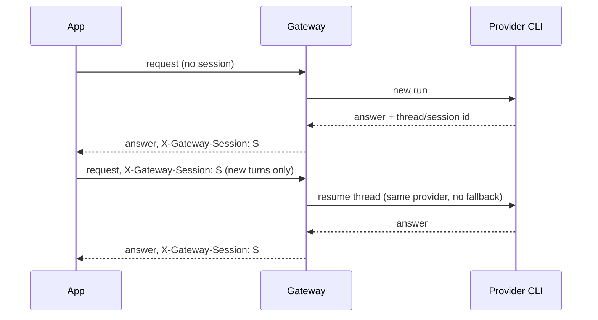

# API

[← Documentation index](README.md)

The base URL is `http://127.0.0.1:11435/v1`.

| Endpoint | Purpose | Needs the API key¹ |
| --- | --- | --- |
| `GET /health` | Liveness. Always `{"status": "ok"}`, even with no provider installed. | no |
| `GET /ready` | Readiness per provider. `503` while no provider is ready. | no |
| `GET /v1/models` | Catalogued models from ready providers. | yes |
| `POST /v1/chat/completions` | OpenAI Chat Completions, text only, with coarse SSE streaming. | yes |
| `POST /v1/responses` | A text subset of the Responses API. | yes |
| `POST /v1/agents/run` | Claude Code filesystem agent runs, with explicit permissions. | always² |
| `GET /docs`, `/redoc`, `/openapi.json` | FastAPI's generated interactive docs and schema. | no |

¹ Only when a key is configured. Send `Authorization: Bearer <key>` or `X-Api-Key: <key>`.
² The agent endpoint is disabled until a key is configured, even on loopback.

The examples below send `Authorization: Bearer local`, which matches the Compose default. Drop
the header when running natively with no key configured, or change the value to the configured
token. See [local API authentication](configuration.md#local-api-authentication).

Every response carries an `X-Request-ID` header. The gateway reuses the one you send, or
generates a UUID, and logs it with the request.

## Health and readiness

```bash
curl http://127.0.0.1:11435/ready
```

```json
{
  "status": "ready",
  "providers": {
    "codex":  {"installed": true, "authenticated": true,  "available": true},
    "claude": {"installed": true, "authenticated": false, "available": false}
  }
}
```

`status` is `not_ready`, with HTTP 503, when no provider is available. The result comes from
`codex login status` and `claude auth status`, cached for 10 seconds and shared by concurrent
calls, so polling `/ready` does not start a process per request. A login change shows up within
10 seconds.

## Models

```bash
curl http://127.0.0.1:11435/v1/models \
  -H 'Authorization: Bearer local'
```

```json
{
  "object": "list",
  "data": [
    {"id": "codex/gpt-5.6-sol", "object": "model", "owned_by": "local-gateway"},
    {"id": "claude-code/opus",  "object": "model", "owned_by": "local-gateway"},
    {"id": "subscription/auto", "object": "model", "owned_by": "local-gateway"}
  ]
}
```

Only ready providers are listed, unless a provider sets `advertise_unavailable: true`.
`subscription/auto` is appended whenever at least one model is listed. See
[Models and routing](models-and-routing.md).

## Chat completions

Run Codex:

```bash
curl http://127.0.0.1:11435/v1/chat/completions \
  -H 'Content-Type: application/json' \
  -H 'Authorization: Bearer local' \
  -d '{
    "model": "codex/gpt-5.6-sol",
    "messages": [
      {"role": "user", "content": "Explain Linux namespaces."}
    ]
  }'
```

Run Claude Code:

```bash
curl http://127.0.0.1:11435/v1/chat/completions \
  -H 'Content-Type: application/json' \
  -H 'Authorization: Bearer local' \
  -d '{
    "model": "claude-code/opus",
    "messages": [
      {"role": "user", "content": "Explain Linux namespaces."}
    ]
  }'
```

### Request fields

| Field | Handling |
| --- | --- |
| `model` | Required. See [Models and routing](models-and-routing.md). |
| `messages` | Required, at least one. `role` is `system`, `developer`, `user`, or `assistant`. `content` is a string or a list of `{"type": "text", "text": "..."}` parts. |
| `stream` | `true` for [SSE streaming](#streaming). |
| `gateway_session_id` | Continue a session; same as the `X-Gateway-Session` header. |
| `tools`, `tool_choice` | Rejected with `400 unsupported_feature`, even when empty. |
| `temperature`, `top_p`, `max_tokens`, `max_completion_tokens`, `stop`, `user` | Validated, then **ignored**. The agent CLIs have no stable equivalents. |
| Anything else (`n`, `response_format`, `seed`, …) | Accepted and ignored. |

Image, audio, and file content parts and the `tool`/`function` roles fail validation with
`400 request_validation_error`. A message's `name` is accepted but not passed on.

Being ignored is part of why the gateway does not describe itself as a raw model API: the
runtime decides sampling, length, and stopping.

### Response

```json
{
  "id": "chatcmpl-…",
  "object": "chat.completion",
  "created": 1793145600,
  "model": "codex/gpt-5.6-sol",
  "choices": [
    {"index": 0, "message": {"role": "assistant", "content": "…"}, "finish_reason": "stop"}
  ],
  "usage": {"prompt_tokens": 812, "completion_tokens": 240, "total_tokens": 1052},
  "gateway_session_id": "6f1c…"
}
```

`model` echoes the requested name. `finish_reason` is always `stop`. The headers
`X-Gateway-Session`, `X-Gateway-Provider`, and `X-Gateway-Model` are described under
[Sessions](#sessions).

## Streaming

```bash
curl -N http://127.0.0.1:11435/v1/chat/completions \
  -H 'Content-Type: application/json' \
  -H 'Authorization: Bearer local' \
  -d '{
    "model": "subscription/auto",
    "stream": true,
    "messages": [{"role": "user", "content": "Write a haiku."}]
  }'
```

Neither CLI exposes stable token deltas, so streams are **coarse**: the whole answer arrives as
one content chunk once the run finishes.

| API | Events, in order |
| --- | --- |
| Chat | a `role: assistant` chunk → one content chunk → a chunk with `finish_reason: "stop"` → `data: [DONE]` |
| Responses | `response.created` → one `response.output_text.delta` → `response.completed` (with `output_text`) → `data: [DONE]` |

Streams carry no usage block. Streaming responses return only the `X-Gateway-Session` header,
plus `Cache-Control: no-cache` and `X-Accel-Buffering: no`, because the provider is chosen after
the headers are sent.

Request, routing, and session errors still return a normal JSON error status. A provider
failure after the stream has started arrives **inside** the HTTP 200 stream as
`data: {"error": {...}}` (chat) or `data: {"type": "error", "error": {...}}` (Responses),
followed by `data: [DONE]`. A new stream can fall back to another provider only before any text
was sent. If a new stream fails before any output, its session is discarded. Disconnecting
cancels and reaps the child process.

## Responses API

```bash
curl http://127.0.0.1:11435/v1/responses \
  -H 'Content-Type: application/json' \
  -H 'Authorization: Bearer local' \
  -d '{"model":"subscription/auto","input":"Explain cgroups briefly."}'
```

| Field | Handling |
| --- | --- |
| `model` | Required. |
| `input` | A string, or a list of messages: `role` plus a string or a list of `input_text`, `output_text`, or `text` parts. Message items may include `"type": "message"`. |
| `instructions` | Sent ahead of the input as a `developer` message. |
| `stream` | `true` for [SSE streaming](#streaming). |
| `gateway_session_id`, or `metadata.gateway_session_id` | Continue a session. |
| `tools`, `previous_response_id` | Rejected with `400 unsupported_feature`. Use `X-Gateway-Session` for continuation. |
| `max_output_tokens`, `temperature` | Validated, then ignored. |
| Anything else (`reasoning`, `text`, `store`, …) | Accepted and ignored. |

Earlier output can be sent back as `assistant` messages with `output_text` parts; extra keys
such as `annotations` are ignored. Non-text parts such as `input_image` and `input_file`, and
non-message items such as function calls, fail validation with `400 request_validation_error`.

The response has `object: "response"`, `status: "completed"`, one assistant `message` item with an
`output_text` part, a top-level `output_text`, `usage` with `input_tokens`/`output_tokens`/
`total_tokens`, and `gateway_session_id`.

## Python OpenAI client

```python
from openai import OpenAI

client = OpenAI(
    base_url="http://127.0.0.1:11435/v1",
    # The configured GATEWAY_API_KEY. Any non-empty value works only when the
    # gateway runs with no key configured.
    api_key="local",
)

response = client.chat.completions.create(
    model="codex/gpt-5.6-sol",
    messages=[
        {
            "role": "user",
            "content": "Write a Rust implementation of an LRU cache.",
        }
    ],
)

print(response.choices[0].message.content)
```

## Sessions

Each new conversation gets a gateway session ID, a UUID. It is returned in the
`X-Gateway-Session` header, and in the body as `gateway_session_id` (chat, Responses) or
`session_id` (agents). Continue the provider thread by sending it back, either as the header or
as `gateway_session_id` in the body. If you send both, they must match; otherwise the request
fails with `conflicting_session_ids`.

```bash
curl http://127.0.0.1:11435/v1/chat/completions \
  -H 'Content-Type: application/json' \
  -H 'Authorization: Bearer local' \
  -H 'X-Gateway-Session: <uuid>' \
  -d '{
    "model": "codex/gpt-5.6-sol",
    "messages": [{"role": "user", "content": "Now compare them with cgroups."}]
  }'
```



How continuation works:

- Codex resumes with `codex exec resume <thread-id>`, and Claude with `--resume <session-id>`,
  when the runtime returned an ID. A continuation returns the same gateway session ID.
- The provider thread already holds the earlier turns. The gateway still sends every message in
  the request, so send **only the new turns** when continuing, or the context is duplicated.
- Sessions are pinned to their provider. Cross-provider fallback is disabled on continuation to
  prevent incoherent context.
- The model cannot change. Send the session's original model or `subscription/auto`. Anything else
  fails with `session_model_mismatch`.
- Sessions are also bound to their API type. An agent session cannot be resumed through chat, and
  its resolved working directory and permission level cannot change. Violations fail with
  `session_context_mismatch`.
- Requests that continue the same session run one at a time, in order.
- An unknown or expired ID fails with `404 session_not_found`. By default a session expires
  after 30 days without use; see [configuration](configuration.md#storage).

Non-streaming responses also carry:

| Header | Value |
| --- | --- |
| `X-Gateway-Provider` | The provider that ran: `codex` or `claude`. Check it when `subscription/auto` or a fallback may have switched providers. |
| `X-Gateway-Model` | The alias of the model that ran. After `subscription/auto` or a fallback, this is the chosen provider's model, such as `claude-code/opus`, and it stays the same for the rest of the session. |

### Role handling

Messages use deterministic role markers (`[SYSTEM]`, `[DEVELOPER]`, `[USER]`, `[ASSISTANT]`).
Those markers preserve ordering, but provider runtimes may still add their own instructions,
tools, agent loops, filesystem context, permission handling, compaction, and model-specific
behavior. OpenAI `system` and `developer` roles therefore cannot be reproduced exactly.

The rendered conversation goes to the CLI on its standard input, not as a command-line argument,
so long conversations are not limited by the operating system's argument size. Each run is still
bounded by `timeout_seconds` and by the model's own context window.

## Agent endpoint

`POST /v1/agents/run` exposes the filesystem-agent nature explicitly:

```bash
curl http://127.0.0.1:11435/v1/agents/run \
  -H 'Content-Type: application/json' \
  -H 'Authorization: Bearer local' \
  -d '{
    "model": "claude-code/sonnet",
    "prompt": "Find the failing tests and explain the cause.",
    "cwd": "/home/user/workspace/project",
    "permissions": "read-only"
  }'
```

```json
{
  "id": "agent_…",
  "model": "claude-code/sonnet",
  "status": "completed",
  "output": "…",
  "session_id": "6f1c…",
  "provider": "claude"
}
```

| Field | Handling |
| --- | --- |
| `model` | Required. A `claude-code/*` model, or `subscription/auto`, which picks Claude. |
| `prompt` | Required. The task. |
| `cwd` | Required. Must exist, be a directory, and resolve (after following symlinks) inside `agent.allowed_directories`, unless `agent.allow_outside_directories` is `true`. A relative path is resolved against the gateway's own working directory. |
| `permissions` | `read-only` (default) or `workspace-write`. |
| `gateway_session_id` | Continue an agent session; the header works too. |
| `fallback` | Defaults to `false`. Writes fall back only with `fallback: true` **and** `agent.allow_write_fallback: true`. Claude is currently the only agent-capable provider, so there is nothing to fall back to yet. |

Unknown fields are rejected, and the endpoint does not stream. A missing gateway key, or a `cwd`
that is missing, not a directory, or outside the allowed roots, fails with
`403 agent_permission_error`.

What the agent can do:

| `permissions` | Claude tools | Permission mode |
| --- | --- | --- |
| `read-only` | `Read`, `Glob`, `Grep` | `plan` |
| `workspace-write` | `Read`, `Glob`, `Grep`, `Edit`, `Write` | `acceptEdits` |

Every agent run uses `--restricted --strict-mcp-config --safe-mode`, with the tool list passed
to both `--tools` and `--allowedTools`. Shell and command tools are never exposed.

Agent runs need Claude Code 2.1.248 or newer for these flags. The Docker image pins 2.1.251.
Before an agent run, the gateway checks `claude --version` and refuses an older CLI with
`400 unsupported_provider_capability`, without starting it. If the version cannot be read, the run
goes ahead. The version is read once per gateway process, so restart the gateway after upgrading
the CLI. `doctor` reports the same check.

Codex models return `400 unsupported_provider_capability` on this endpoint, because Codex's CLI
sandbox does not confine read access to the requested directory.

In Docker, use the **container** path rather than the host path:

```json
{
  "cwd": "/home/gateway/workspace/my-project",
  "permissions": "workspace-write"
}
```

## Errors

Every error uses the OpenAI-style shape:

```json
{"error": {"message": "…", "type": "provider_timeout", "code": "provider_timeout", "provider": "codex"}}
```

`provider` is present when a specific provider failed. `request_validation_error` adds a
`details` list from the request validator.

"May fall back" means a new, non-session request can move to the next provider when
[fallback](models-and-routing.md#routing-fallback-and-queuing) is enabled.

| `code` | `type` | HTTP | May fall back | When |
| --- | --- | --- | --- | --- |
| `request_validation_error` | `invalid_request` | 400 | — | The body does not match the schema, or its text is not valid Unicode (an unpaired surrogate) |
| `unsupported_feature` | `invalid_request` | 400 | — | `tools`, `tool_choice`, or `previous_response_id` |
| `conflicting_session_ids` | `invalid_request` | 400 | — | Header and body session IDs differ |
| `session_model_mismatch` | `invalid_request` | 400 | — | Continuing a session with a different model |
| `session_context_mismatch` | `invalid_request` | 400 | — | Continuing a session with a different API type, `cwd`, or permissions |
| `unsupported_provider_capability` | `invalid_request` | 400 | — | A Codex model, or a Claude Code older than 2.1.248, on the agent endpoint |
| `invalid_model_name` | `invalid_request` | 400 | — | A stored session's model fails the name rules |
| `invalid_api_key` | `authentication_error` | 401 | — | Missing or wrong gateway key |
| `agent_permission_error` | `agent_permission_error` | 403 | — | No gateway key configured, or `cwd` rejected |
| `model_not_available` | `model_not_available` | 404 | `subscription/auto` only | Unknown name, or the CLI or plan rejects the model |
| `session_not_found` | `session_not_found` | 404 | — | Unknown or deleted session ID |
| `provider_usage_limit` | `provider_usage_limit` | 429 | yes | The plan's usage or rate limit was hit |
| `provider_execution_failed` | `provider_protocol_error` | 502 | yes | The CLI failed for another reason |
| `provider_malformed_output` | `provider_protocol_error` | 502 | yes | The CLI printed output the gateway cannot parse |
| `provider_missing_output` | `provider_protocol_error` | 502 | yes | The CLI finished without an answer |
| `provider_unavailable` | `provider_unavailable` | 503 | yes | Not installed, disabled, failed to start, or `working_directory` missing |
| `provider_temporary_error` | `provider_unavailable` | 503 | yes | The provider reported an overload or temporary outage |
| `provider_not_authenticated` | `provider_not_authenticated` | 503 | yes¹ | The CLI is not signed in |
| `provider_timeout` | `provider_timeout` | 504 | yes | The run exceeded `timeout_seconds` |

¹ Falls back when the pre-run login check detects it. Not when the CLI itself reports it during a
run.
