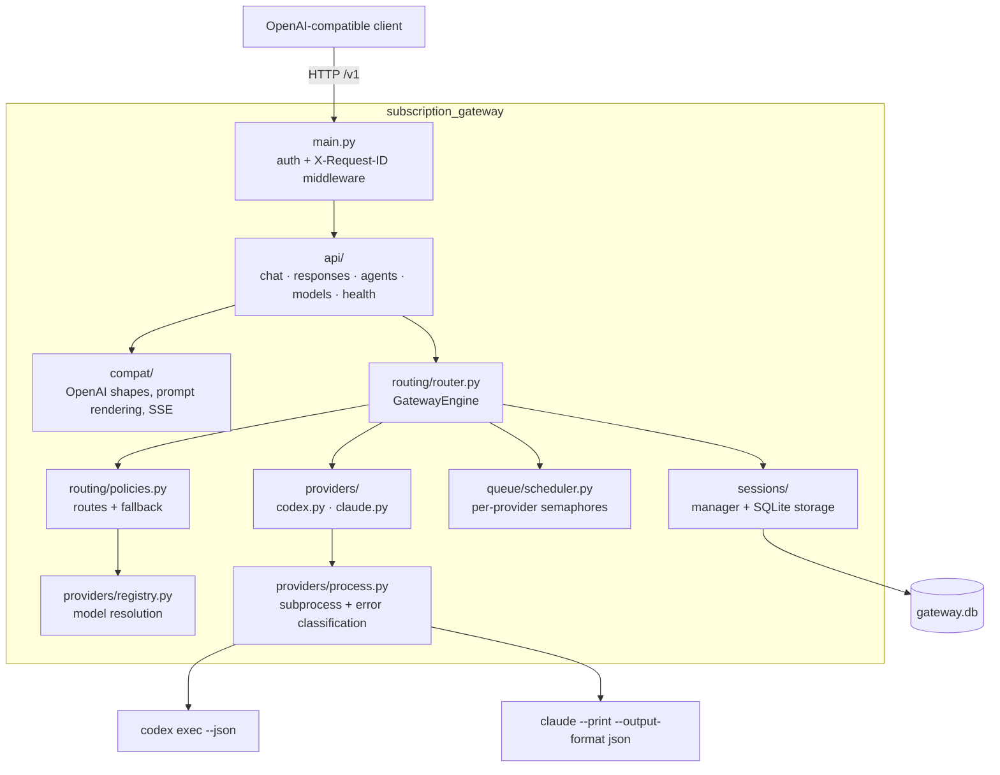

# Architecture and development

[← Documentation index](README.md)



## Package layout

`src/subscription_gateway/`:

| Module | Responsibility |
| --- | --- |
| `main.py` | FastAPI application factory, local API-key and `X-Request-ID` middleware, error handlers |
| `cli.py` | The `serve` / `status` / `doctor` command line |
| `config.py` | Pydantic settings model, YAML loading, environment overrides, bind validation |
| `logging.py` | Text or JSON log formatting, with secret-name masking in JSON mode |
| `errors.py` | `GatewayError` / `ProviderError` and the normalized error constructors |
| `model_names.py` | `subscription/auto`, provider prefixes, the model-name pattern, legacy aliases |
| `api/` | Routers: `chat`, `responses`, `agents`, `models`, `health` |
| `compat/` | OpenAI request and response shapes, prompt assembly, streaming chunks |
| `providers/` | The `Provider` protocol, the Codex and Claude adapters, subprocess handling and failure classification (`process.py`), and the registry that resolves model names |
| `routing/` | Route selection and fallback policy (`policies.py`) and request orchestration (`router.py`) |
| `sessions/` | Session records, their SQLite storage, and the manager that enforces session binding, per-session serialization, and retention cleanup |
| `queue/` | Per-provider concurrency semaphores |

## Provider implementation notes

Both adapters build argument arrays and run them without a shell. The model name is checked
against the strict name pattern again just before each run. The rendered conversation is written to
the CLI's standard input (`-` tells Codex to read it; Claude's `--print` reads it by default), so
prompt text never appears in the argument list, and its size is not capped by Linux's 128 KiB
limit on one argument.

| Run | Command line |
| --- | --- |
| Codex chat, new | `codex exec --json --color never --model M --ignore-user-config --sandbox read-only --skip-git-repo-check -` |
| Codex chat, resume | `codex exec resume --json --model M --ignore-user-config --skip-git-repo-check -c sandbox_mode="read-only" THREAD_ID -` |
| Claude chat | `claude --print --output-format json --safe-mode --model M [--resume ID] --tools "" --permission-mode plan` |
| Claude agent | `claude --print --output-format json --safe-mode --model M [--resume ID] --restricted --strict-mcp-config --tools T --allowedTools T --permission-mode plan\|acceptEdits` |
| Login checks | `codex login status`, `claude auth status` |

The Codex adapter uses the official documented `codex exec --json` JSONL interface. It reads the
`thread.started` thread ID, every completed `agent_message` item (joined with blank lines into
the answer), `turn.completed` usage, and error events. Authentication is checked with
`codex login status`, and the CLI reuses its own saved ChatGPT/Codex authentication. See the
official [Codex non-interactive mode
documentation](https://learn.chatgpt.com/docs/non-interactive-mode).

Codex chat runs in `providers.codex.working_directory` (default: your home directory) under its
read-only sandbox. The sandbox blocks writes but not reads, which is why Codex is not offered as a
filesystem agent.

The Claude adapter uses `claude --print --output-format json`, checks `claude auth status`, keeps
stdout and stderr separate, and resumes returned session IDs. Chat runs get no tools at all. The
adapter is isolated behind `Provider`, so a future Claude Agent SDK implementation can replace it
without changing routing or HTTP code.

Filesystem-agent execution is intentionally narrower than chat. Claude Code runs in restricted
mode with only its built-in file tools, while Codex is not exposed as a filesystem agent because
its current sandbox cannot enforce the configured read root. Session records bind continuations
to their original API type, directory, and permissions.

CLI failures are classified from their output (`providers/process.py`) into the normalized
[error codes](api.md#errors): login problems, usage limits, rejected models, temporary outages,
and a generic execution failure.

## Platform support

Linux is the primary target. The implementation uses `pathlib`, `shutil.which`, argument-array
subprocesses, and cross-platform process termination where practical, so macOS should work.
Windows users should run the gateway in WSL. CI tests Python 3.12 and 3.13.

## Development checks

```bash
make dev            # install with development extras
make check          # lint (ruff check + ruff format --check), typecheck, coverage
make coverage       # the test suite with a coverage report and the 85% floor
```

Individually (drop `uv run` inside an activated `.venv`):

```bash
uv run pytest
uv run ruff check .
uv run ruff format --check .
uv run mypy          # strict; checks src/ and tests/ as configured in pyproject.toml
```

Tests use mock providers and mocked process results. They do not require provider installations,
credentials, network access, or subscription usage.

See [CONTRIBUTING.md](../CONTRIBUTING.md) for the full contribution and release workflow.

## Make targets

`make help` (the default target) prints the current list:

| Target | Purpose |
| --- | --- |
| `help` | List every target |
| `install`, `dev` | Install without or with development extras (uv when available, else `.venv` + pip) |
| `lock` | Refresh `uv.lock` |
| `precommit` | Install the pre-commit hooks |
| `config`, `env` | Create `config.yaml` and `.env` from the examples, never overwriting |
| `check` | `lint`, `typecheck`, and `coverage`, the same gate as CI's static and test jobs |
| `test`, `lint`, `typecheck`, `coverage` | Individual checks |
| `format`, `fix` | Apply ruff formatting; `fix` also applies ruff autofixes |
| `serve`, `status`, `doctor` | Run the CLI locally, using `./config.yaml` when it exists |
| `smoke` | Curl `/health` and `/v1/models` against a running gateway |
| `docker-build` | Build the gateway image |
| `up`, `up-webui` | Deploy without or with OpenWebUI |
| `down`, `ps`, `logs` | Stop the stack, or inspect it (always including OpenWebUI) |
| `restart` | Restart the gateway, plus OpenWebUI with `WEBUI=1` |
| `shell`, `docker-status`, `docker-doctor` | Inspect the gateway container |
| `dist`, `clean` | Build the wheel and sdist; remove artifacts and caches |
| `purge CONFIRM=1` | Remove containers and their data volumes (destructive) |

Variables you can pass, as in `make up WEBUI=1`:

| Variable | Default | Used by |
| --- | --- | --- |
| `WEBUI` | `0` | `1`/`true`/`yes`/`on` includes OpenWebUI in `up`, `restart`, and `docker-build` |
| `CONFIG` | `config.yaml` | The config file passed to the CLI and mounted into Docker when it exists |
| `API_KEY` | `$GATEWAY_API_KEY`, else `local` | The key `smoke` sends |
| `PORT`, `BASE_URL` | `11435`, `http://127.0.0.1:$(PORT)` | The URL `smoke` calls and `up` prints. This does not change the port the gateway binds. |
| `CONFIRM` | — | Must be `1` for `purge` |
| `VENV`, `COMPOSE` | `.venv`, `docker compose` | The virtualenv path and the Compose command |
