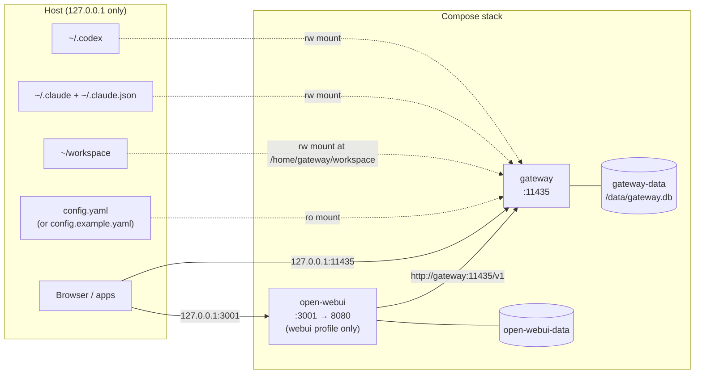

# Docker

[← Documentation index](README.md)

The supplied image installs pinned, tested releases of the official Codex and Claude Code
clients. Provider credentials are never copied into an image: Compose mounts the host's existing
client state only at runtime. The published ports are bound to `127.0.0.1`, and the gateway
container runs as a non-root user with all Linux capabilities dropped and `no-new-privileges`.



## Start the stack

First authenticate the official clients on the host and confirm both statuses:

```bash
codex login status
claude auth status
```

Then start the gateway, deciding whether the optional chat UI is deployed with it:

```bash
export GATEWAY_API_KEY=local        # Change this if desired

make up                             # gateway only
make up-webui                       # gateway and OpenWebUI

make ps
make docker-status
```

The `make` targets export `GATEWAY_UID` from `id -u` themselves. Without `make`, set it by
hand and select the profile explicitly:

```bash
export GATEWAY_UID="$(id -u)"                          # Linux; usually 1000
docker compose up --build --detach                     # gateway only
docker compose --profile webui up --build --detach     # gateway and OpenWebUI
```

When OpenWebUI is deployed, open the chat UI at `http://127.0.0.1:3001` (or the
`OPEN_WEBUI_PORT` you set). Both the UI and gateway API ports are bound to the host loopback
interface. The first OpenWebUI account becomes the local administrator; keep its credentials
private even though the service is not published remotely.

The first image build installs Codex and Claude Code and can take several minutes. Subsequent
starts use the cached image.

Test it from the host:

```bash
make smoke            # curls /health and /v1/models with $GATEWAY_API_KEY (default: local)

curl http://127.0.0.1:11435/v1/models \
  -H 'Authorization: Bearer local'
```

## Compose defaults

- API key: `local`;
- Codex state: `$HOME/.codex` mounted at `/home/gateway/.codex`;
- Claude state: `$HOME/.claude` mounted at `/home/gateway/.claude`;
- Claude user state: `$HOME/.claude.json` mounted at `/home/gateway/.claude.json`;
- agent workspace: `$HOME/workspace` mounted at `/home/gateway/workspace`;
- SQLite metadata: the Docker-managed `gateway-data` volume, at `/data/gateway.db`;
- OpenWebUI: not deployed unless the `webui` profile is selected; when it is,
  `http://127.0.0.1:3001`, with data in the `open-webui-data` volume.

## Pinned versions

| Component | Version | Override with |
| --- | --- | --- |
| Codex CLI (`@openai/codex`) | `0.163.0` | `CODEX_VERSION` |
| Claude Code (`@anthropic-ai/claude-code`) | `2.1.251` | `CLAUDE_CODE_VERSION` |
| OpenWebUI image | `v0.11.0-slim` | `OPEN_WEBUI_VERSION` |
| Node.js base (for the CLIs) | `26-slim` | — (Dockerfile) |
| Python base | `3.12-slim` | — (Dockerfile) |
| uv (build only, removed from the final image) | `0.11.21` | `UV_VERSION` build arg |

Python dependencies are installed from the checked-in `uv.lock` with hash verification. Changing
a CLI version takes effect on the next build (`make up` always rebuilds). The image disables the
Claude Code auto-updater, so the pinned release stays in place.

## Compose variables

Compose reads these from the shell or from a `.env` file next to `docker-compose.yml`.
`make env` creates `.env` from [`.env.docker.example`](../.env.docker.example) without
overwriting an existing one.

| Variable | Default | Effect |
| --- | --- | --- |
| `GATEWAY_API_KEY` | `local` | Gateway token; also given to OpenWebUI as its API key. An empty value still means `local`. |
| `ANTHROPIC_API_KEY` | empty | Forwarded to the gateway so Claude Code uses an API key instead of the mounted login |
| `COMPOSE_PROFILES` | empty | `webui` makes every `docker compose` command include OpenWebUI |
| `GATEWAY_CONFIG_FILE` | `./config.example.yaml` | Host file mounted read-only as the gateway's `config.yaml`. The `make` targets use `./config.yaml` once it exists. |
| `GATEWAY_UID` | `1000` (`make` uses `id -u`) | UID of the container user, so mounted client state stays writable |
| `HOST_CODEX_HOME` | `$HOME/.codex` | Host Codex state |
| `HOST_CLAUDE_HOME` | `$HOME/.claude` | Host Claude state directory |
| `HOST_CLAUDE_CONFIG` | `$HOME/.claude.json` | Host Claude user-state file |
| `GATEWAY_WORKSPACE` | `$HOME/workspace` | Host directory mounted at `/home/gateway/workspace` for agent runs |
| `OPEN_WEBUI_PORT` | `3001` | Host port for OpenWebUI |
| `OPEN_WEBUI_SECRET_KEY` | empty (generated) | OpenWebUI session secret; set a stable random value before first start |
| `CODEX_VERSION`, `CLAUDE_CODE_VERSION`, `OPEN_WEBUI_VERSION` | see [Pinned versions](#pinned-versions) | Client and UI releases |
| `APP_VERSION` | `dev` | Version label written into the image metadata |

`.env` only feeds these Compose settings. The gateway container receives only the variables
Compose passes to it explicitly, so native overrides such as `GATEWAY_LOG_LEVEL` or
`GATEWAY_PORT` in `.env` have no effect. Put those settings in `config.yaml`.

## Configuration in Docker

The container reads `config.yaml` from a read-only mount, which is how the model catalog and
other settings are customized in Docker. It defaults to `./config.example.yaml`, and the `make`
targets point it at `./config.yaml` as soon as that file exists:

```bash
make config          # copy config.example.yaml to config.yaml
$EDITOR config.yaml  # add models under providers.<name>.models
make up
```

Without `make`, set `GATEWAY_CONFIG_FILE` yourself. Point it only at a file that exists: Docker
creates a *directory* for a missing bind source, and the gateway then refuses to start.

Compose sets these container variables, and they win over the file:

| Container variable | Value | So this `config.yaml` key is ignored |
| --- | --- | --- |
| `GATEWAY_HOST` | `0.0.0.0` | `server.host` |
| `GATEWAY_ALLOW_REMOTE` | `true` | `server.allow_remote` |
| `GATEWAY_API_KEY` | `${GATEWAY_API_KEY:-local}` | `server.api_key` |
| `GATEWAY_SQLITE_PATH` | `/data/gateway.db` | `storage.sqlite_path` |
| `SUBSCRIPTION_GATEWAY_CONFIG` | `/etc/subscription-gateway/config.yaml` | — (the mounted file) |

Keep `server.port` at `11435` in Docker: the published port and the image health check both use
it.

Running the image without Compose (`docker run`) also needs `-e GATEWAY_API_KEY=…`. The image
binds `0.0.0.0` and refuses to start without a key.

## Credentials in containers

The provider-state mounts are read-write because the official clients refresh their own sessions
and persist conversation metadata. The gateway still never opens or parses credential files. The
adapters use Codex's `--ignore-user-config` and Claude's `--safe-mode`, so host hooks, plugins, and
MCP configuration are not activated by gateway requests. Filesystem-agent requests additionally
use Claude's `--restricted` mode and a file-only tool allowlist rooted at the requested container
workspace. Codex is available for chat but not through the filesystem-agent endpoint.

Codex can store authentication in an OS keyring instead of `$HOME/.codex/auth.json`. A container
cannot access the host keyring. If `docker compose exec gateway codex login status` is not ready,
configure Codex's supported file credential store on the host and run `codex login` there again.
Claude similarly needs its official local client state under the mounted Claude directory and
`.claude.json` file. Do not copy either credential into the repository or Dockerfile.

To use API keys instead of subscription logins, set `ANTHROPIC_API_KEY` in `.env` (Compose
forwards it to the gateway, and Claude Code then prefers it), and run
`codex login --with-api-key` on the host so the mounted `~/.codex` holds an API-key login. See
[Provider authentication](configuration.md#provider-authentication) for when that is required.

Inside the container the gateway listens on `0.0.0.0`, so with a subscription login it logs the
`signed in with a subscription` warning at startup. That is expected while the ports stay
published on `127.0.0.1`; if you publish them anywhere else, switch to API keys first.

`make docker-doctor` runs `doctor` inside the running container. Its `Server port` check always
reports the port as in use there, because the gateway is holding it, and the command then exits
1. The other checks are still meaningful.

For agent requests, use the container path — not the host path. See
[the agent endpoint](api.md#agent-endpoint).

## OpenWebUI

Docker Compose includes a preconfigured OpenWebUI service, but it is optional and is not
deployed unless it is requested. It sits in the Compose `webui` profile, so the gateway can
run on its own for API-only use:

```bash
make up              # gateway only
make up-webui        # gateway and OpenWebUI
```

`make up WEBUI=1` is the same choice spelled as a variable, and the equivalent without
`make` is `docker compose --profile webui up --detach`. To make the choice permanent for
this machine, set `COMPOSE_PROFILES=webui` in `.env`.

With the UI deployed, open `http://127.0.0.1:3001`. On the first visit, create the local
administrator account. The model picker is populated from the gateway's live `/v1/models`
response and shows usable Codex, Claude Code, and routing aliases.

With subscription logins, OpenWebUI should have exactly one account: every other account uses
your subscription. Right after creating the administrator, turn off **Enable New Sign Ups** under
**Admin Panel → Settings → Authentication** and save. Do the same on an existing installation,
and remove or leave unapproved any accounts other than your own under **Admin Panel → Users**.

As a second guard, Compose sets `DEFAULT_USER_ROLE=pending`, so an account created while sign-ups
are open waits for approval. OpenWebUI stores both settings in its data volume on first start, so
an existing `open-webui-data` volume keeps whatever was saved there; check them in the admin
panel's settings.

The decision is reversible at any time. `make up-webui` adds the UI container next to an
already running gateway, and `make down` followed by `make up` leaves the gateway running
without it. The `open-webui-data` volume survives either direction, so accounts and chats
return if the UI is redeployed later; `make purge CONFIRM=1` is the explicit way to delete
those volumes.

The Compose connection uses `http://gateway:11435/v1` on the private container network, and
OpenWebUI starts only after the gateway's health check passes. Ollama is disabled, so the model
picker is not cluttered by an unavailable default backend. The OpenWebUI container uses the
image's own user and capabilities, with `no-new-privileges`. The pinned slim image avoids
bundling a large local embedding model; ordinary chat works normally, while knowledge/RAG
features may download their selected embedding model during the first startup.

OpenWebUI is configured with legacy function calling because Codex and Claude Code are agent
runtimes, not OpenAI tool-calling endpoints. In this mode OpenWebUI performs its compatible
prompt-based tool orchestration and sends ordinary message requests to the gateway. Native
OpenAI `tools` payloads remain rejected by the gateway instead of being silently ignored.

### A separately installed OpenWebUI

For a separately installed OpenWebUI instance, add an OpenAI-compatible connection:

- URL: `http://127.0.0.1:11435/v1` when OpenWebUI runs natively;
- API key: the configured `GATEWAY_API_KEY`, or any non-empty placeholder if auth is disabled;
- model: select a model returned by `/v1/models`.

If OpenWebUI itself runs in Docker, `127.0.0.1` refers to that container. On Docker Desktop use
`http://host.docker.internal:11435/v1`. On Linux, add an explicit host-gateway mapping or use a
carefully configured local container network. Do not broaden the gateway bind without enabling
its API key.

## Stopping

Stop the stack without deleting either persistent volume:

```bash
make down
```

`make down` includes the `webui` profile, so it removes the OpenWebUI container as well even
when the last `make up` did not start it. `make restart` restarts only the gateway unless you add
`WEBUI=1`. `make purge CONFIRM=1` also deletes the data volumes.
