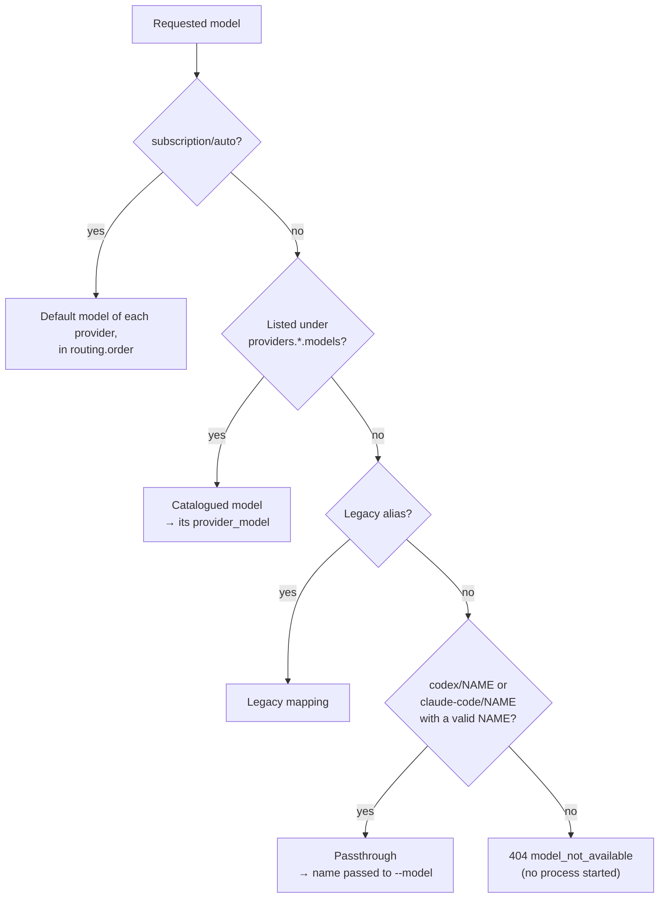
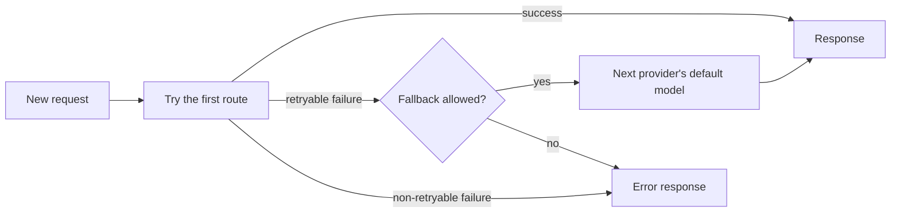

# Models and routing

[← Documentation index](README.md)

Two kinds of model name work: **catalogued** names from the configuration, and **passthrough**
names for anything else the CLI accepts. The gateway resolves a requested name in this order:



## Catalogued models

**Catalogued** models are the ones listed under `providers.<name>.models` in the
[configuration](configuration.md#providerscodex--providersclaude). They are the only names
`/v1/models` can advertise, so they are what a client's model picker shows. The defaults:

| Model | Runs as |
| --- | --- |
| `codex/gpt-5.6-sol` | `codex --model gpt-5.6-sol` |
| `claude-code/opus` | `claude --model opus` |
| `claude-code/sonnet` | `claude --model sonnet` |
| `claude-code/haiku` | `claude --model haiku` |
| `claude-code/fable` | `claude --model fable` |
| `subscription/auto` | the `default: true` model of the first provider in `routing.order` |

The Claude entries are tier aliases, so they always resolve to the newest model of that tier
without a config change.

`subscription/auto` is reserved. It is listed in `/v1/models` whenever any other model is.

## Passthrough models

**Passthrough** covers everything else: any `codex/<model>` or `claude-code/<model>` that is not
catalogued has its suffix passed to the CLI verbatim.

```bash
curl http://127.0.0.1:11435/v1/chat/completions \
  -H 'Content-Type: application/json' \
  -H 'Authorization: Bearer local' \
  -d '{
    "model": "claude-code/claude-fable-5",
    "messages": [{"role": "user", "content": "Explain Linux namespaces."}]
  }'
```

Four things to know about passthrough:

- Names are validated before reaching the CLI. A name must start with a letter, digit, or
  underscore, may otherwise contain only letters, digits, `.`, `_`, `:`, and `-`, and is at most
  128 characters long. Anything else — an empty suffix, a leading `-`, spaces, slashes — is
  rejected with 404 without starting a subprocess. Configured `provider_model` values follow
  the same rule.
- Passthrough models cannot appear in `/v1/models`, because neither CLI can enumerate its models.
  OpenWebUI's picker has no free-text field, so passthrough is for API callers. To use a model in
  a UI, add it to `models` in `config.yaml` and it becomes catalogued.
- The Codex adapter runs with `--ignore-user-config`, so model profiles and aliases defined in
  `~/.codex/config.toml` do **not** resolve. Only names the Codex CLI accepts natively work.
- If the runtime rejects the model, the request fails with `model_not_available` rather than
  falling back to another provider.

Configured aliases are not automatic guarantees of account-level model access. If a local client
version or plan does not offer an alias's `provider_model`, the gateway returns
`model_not_available`. Newer models can also need a newer CLI; the Docker image pins tested
releases (see [Docker](docker.md#pinned-versions)).

## Legacy aliases

`claude-code/opus-5`, the alias earlier versions shipped, still resolves to `opus` but is no longer
advertised. Sessions started under it keep working. Note that continuing such a session while
sending `claude-code/opus` returns `session_model_mismatch`: the names are compared as strings even
though they select the same model.

## Routing, fallback, and queuing



Which routes a request gets:

| Request | Routes, in order |
| --- | --- |
| `subscription/auto` | The default model of each provider in `routing.order`. With `routing.fallback: false`, only the first one. |
| An explicit `codex/*` or `claude-code/*` model | That model, then (with fallback on) the default model of each other provider in `routing.order` |
| A continued session | Only the session's provider and model |
| An agent run | Only agent-capable providers (Claude). See [the agent endpoint](api.md#agent-endpoint). |

Fallback rules:

- Fallback applies only to **new** requests, never to a continued session.
- **Retryable** failures can fall back: `provider_unavailable`, `provider_temporary_error`,
  `provider_not_authenticated` (when the login check finds it before the run),
  `provider_usage_limit`, `provider_timeout`, `provider_execution_failed`,
  `provider_malformed_output`, and `provider_missing_output`. See the
  [error reference](api.md#errors).
- If the runtime rejects a model the caller **named**, the request never falls back. No other
  provider can supply that model, and answering from a different one would misattribute the
  reply. `subscription/auto` still falls back, because the caller named no model.
- Request errors (validation, sessions, unsupported features) never fall back.
- A provider missing from `routing.order` is never used by `subscription/auto` or as a fallback
  target. It can still be called by an explicit model name.
- Write-capable agent runs do not fall back unless both the request's `fallback: true` and
  `agent.allow_write_fallback: true` are set.
- A stream can fall back only before it has sent any text.

Check `X-Gateway-Provider` on non-streaming responses to see which provider actually answered.
Streaming responses cannot declare it, because the provider may change after the headers are
sent.

Sessions and queuing:

- Existing sessions never cross providers or API types, and cannot change agent directories or
  permissions. Requests continuing one session execute serially.
- Each provider has a concurrency limit, `max_concurrent`: by default two Codex runs and one
  Claude run. Excess requests wait in an unbounded queue. `timeout_seconds` (default 300) limits
  each CLI run, not the time spent waiting.
- Provider readiness (installed, enabled, signed in) is cached for 10 seconds.

Unavailable providers are not advertised unless their `advertise_unavailable` setting is true.
This setting affects discovery only; an actual request still returns a normalized error.
