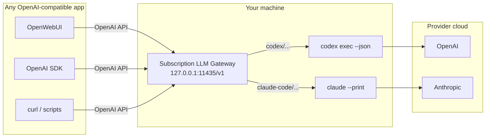
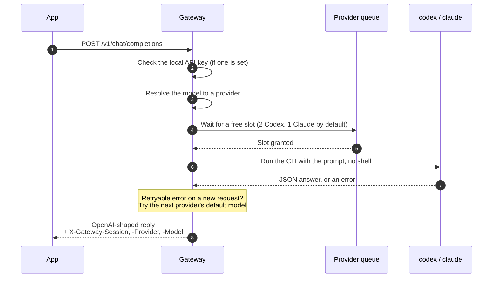
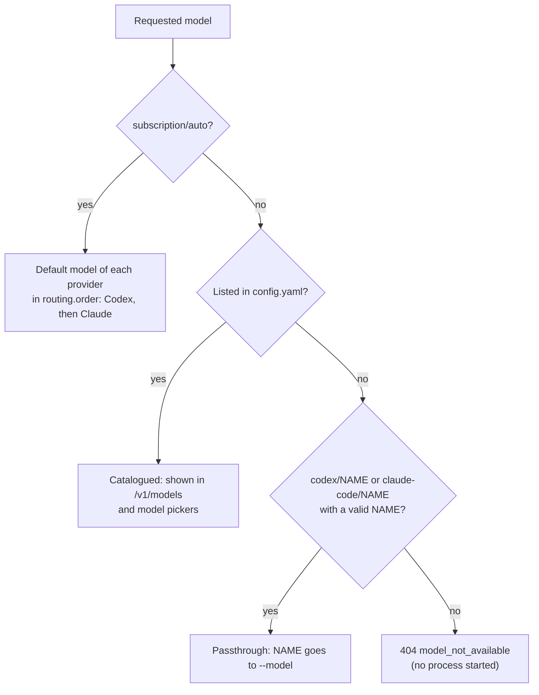
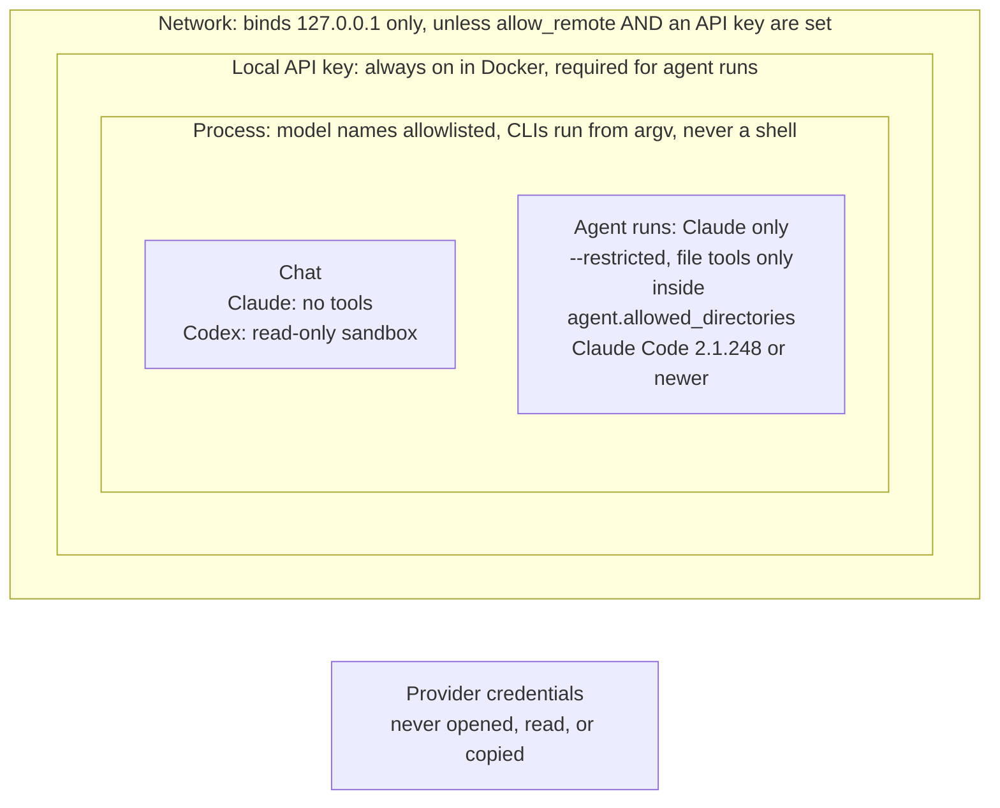
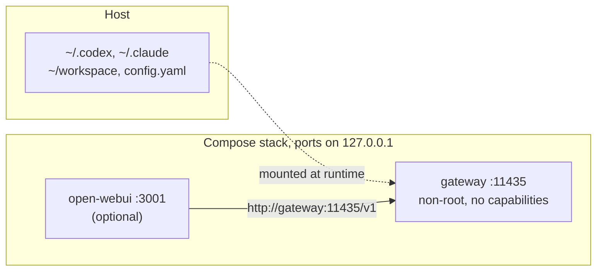
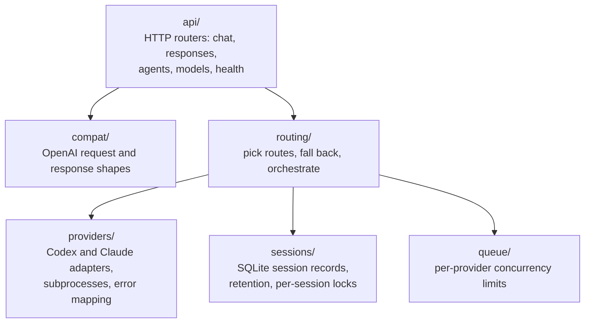
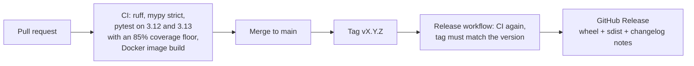

# Subscription LLM Gateway in 5 minutes

[← Documentation index](README.md)

**A localhost adapter that lets any OpenAI-compatible app use the Codex and Claude Code CLIs you
are already signed in to.** This page is a talk-through, built to explain the project to someone in
about five minutes: one idea per section, each carried by one picture. The reference guides linked
at the end have the details. It describes version 0.2.2.

| Time | Section | The one thing to say |
| --- | --- | --- |
| 0:00 | [The problem](#1-the-problem) | Apps speak the OpenAI API; your subscriptions live in two CLIs |
| 0:30 | [Big picture](#2-the-big-picture) | A small local server translates one into the other |
| 1:00 | [Is / is not](#3-what-it-is-and-is-not) | A personal adapter, not a model and not a way to share an account |
| 1:30 | [One request](#4-one-request-step-by-step) | Check key, pick model, queue, run CLI, maybe fall back, reply |
| 2:00 | [Models](#5-models-and-routing) | Named models, passthrough names, and `subscription/auto` |
| 2:30 | [Safety](#6-safety-boundaries) | Loopback, a local key, no shell, fenced-in agents, no credentials |
| 3:15 | [Running it](#7-ways-to-run-it) | Natively, in Docker, or in Docker with a chat UI |
| 3:45 | [The code](#8-inside-the-code) | Routers, a routing engine, two provider adapters, sessions |
| 4:15 | [Shipping](#9-how-changes-ship) | PR, strict CI, tag, automatic GitHub Release |
| 4:40 | [Limits](#10-known-limits) | What it deliberately does not do, and what is still open |

## 1. The problem

Many tools, OpenWebUI, the OpenAI SDKs, and countless scripts, can talk to "an OpenAI-compatible
API". People with a ChatGPT or Claude subscription already have the official `codex` and `claude`
command-line clients signed in, but those clients are not an HTTP API. The gateway bridges the gap
without touching anyone's credentials.

Inference is **not** local: every answer still comes from OpenAI or Anthropic, under the user's plan
and its usage limits.

## 2. The big picture

An app sends a normal Chat Completions or Responses request. The gateway runs the matching CLI as a
subprocess, reads its JSON output, and returns an OpenAI-shaped reply. The CLIs keep their own
logins; the gateway only stores session metadata in SQLite.

## 3. What it is and is not

| ✅ It is | ❌ It is not |
| --- | --- |
| A personal, localhost-first adapter | A local model |
| A thin wrapper around the official, signed-in CLIs | A replacement for the provider developer APIs |
| Honest about what runs: `codex/...` and `claude-code/...` names | A raw model API with identical behavior |
| Credential-free: logins stay with the CLIs | A way to share, resell, or stretch a subscription |

> [!IMPORTANT]
> A subscription login is for **one person, on their own machine**. Anything shared, remote,
> multi-user, or automated beyond that needs API keys. `doctor` and `serve` warn when a
> subscription-backed gateway listens on a non-loopback address.

## 4. One request, step by step

Send `X-Gateway-Session` back to continue the conversation. A continued session always stays on
the provider it started with, so its context never mixes across providers. Streaming works, but
coarsely: the CLIs give no token deltas, so the whole answer arrives as one chunk.

## 5. Models and routing

- Out of the box: `codex/gpt-5.6-sol`, `claude-code/opus`, `sonnet`, `haiku`, `fable`, and
  `subscription/auto`. Any other model the CLI accepts works as a passthrough name.
- **Fallback:** a new request that hits a usage limit, timeout, or outage can move to the other
  provider. A model the caller named explicitly never falls back when the CLI rejects that model,
  because no other provider can supply it.

## 6. Safety boundaries

- `/v1/agents/run` lets Claude Code read (and optionally edit) files, so it gets the tightest fence:
  a configured key, a directory allowlist, restricted mode with file tools only, and no shell.
- Codex is chat-only: its sandbox cannot confine reads to one directory, so it is not offered as an
  agent.
- The gateway never reads cookies, extracts tokens, intercepts traffic, or calls undocumented
  endpoints. See [SECURITY.md](../SECURITY.md) for what counts as a vulnerability.

## 7. Ways to run it

| Setup | Command | Where | Notes |
| --- | --- | --- | --- |
| Native | `make install && make serve` | `127.0.0.1:11435/v1` | No key needed on loopback, except for agents |
| Docker | `make up` | `127.0.0.1:11435/v1` | Pinned CLIs; key defaults to `local` |
| Docker + chat UI | `make up-webui` | `127.0.0.1:3001` | Adds a preconfigured OpenWebUI |

Credentials are never baked into the image: Compose mounts the host's existing CLI state when the
container starts. `make doctor` checks a native setup in one command.

## 8. Inside the code

Python 3.12+, FastAPI, Pydantic. Each provider sits behind one `Provider` interface, so adding or
replacing an adapter does not touch routing or HTTP code. `config.py` holds every setting, and
`cli.py` provides `serve`, `status`, and `doctor`. Details: [Architecture](architecture.md).

## 9. How changes ship

Tests never need a real CLI, credentials, or network: providers are faked at the `Provider`
boundary. `main` is protected by a ruleset, and every release comes from its own PR that bumps the
version and the changelog. Nothing is published to PyPI or a container registry.

## 10. Known limits

By design:

| Limit | Why |
| --- | --- |
| Text only; no OpenAI tool calls, images, or files | The CLIs are agent runtimes, not tool-calling endpoints |
| `temperature`, `max_tokens`, `stop` are accepted but ignored | The CLIs have no stable equivalents |
| Coarse streaming: one chunk per answer | The CLIs expose no token deltas |
| Not multi-user | Subscription terms cover one person's own use |

Still open (from the documentation audit):

- The whole conversation is one command-line argument, so very long chats fail at about 128 KiB.
- The agent endpoint's `fallback` option does nothing yet; Claude is the only agent provider.
- `doctor` reports the port as in use while the gateway itself is running.
- `provider_not_authenticated` falls back or not depending on where it is detected.
- The pinned versions in `.env.docker.example` are not covered by tests.
- Config accepts model aliases with no provider prefix.

## Read next

| Guide | When you need |
| --- | --- |
| [README](../README.md) | Install and first request |
| [Configuration](configuration.md) | Every setting, the CLI, and `doctor` |
| [API](api.md) | Request fields, streaming, sessions, agents, error codes |
| [Models and routing](models-and-routing.md) | Name resolution and fallback in full |
| [Docker](docker.md) | The image, Compose variables, and OpenWebUI |
| [Architecture](architecture.md) | Package layout, provider command lines, `make` targets |
| [SECURITY.md](../SECURITY.md) | Design boundaries and how to report issues |
